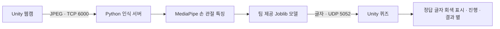

# 개발 구조와 실행 안내

## 인식 흐름



네트워크 값은 보관된 코드에서 확인한 값입니다. Python 서버는 TCP 6000에서 프레임을 받고 UDP 5052로 결과를 전달합니다. 여러 실험용 수신 스크립트가 함께 있으므로 실제 씬에 연결된 컴포넌트를 Inspector에서 확인해야 합니다.

## Unity 원본 열기

1. Unity Hub에 `source/unity/SignPlay`를 추가합니다.
2. `ProjectVersion.txt`에 기록된 Unity **2022.3.62f1**로 엽니다.
3. Packages 복원과 Library 재생성을 기다립니다.
4. `Assets/Scenes`에서 퀴즈 관련 씬과 Inspector 연결을 확인합니다.

`ProcessStarter.cs`의 보관된 코드는 에디터 실행 시 서버 실행/준비 확인을 건너뜁니다. 에디터에서 인식을 확인할 때는 Python 서버를 별도로 실행해야 합니다. Windows 빌드에서는 게임 폴더의 `unity_stream_server.exe`를 찾습니다.

## Python 코드

기존 가상환경은 Python 3.10.11로 생성됐습니다. 가상환경 자체는 올리지 않았으며, 설치돼 있던 패키지 버전은 [`environment-observed.txt`](../source/python/environment-observed.txt)에 기록했습니다. 이 목록은 검증된 잠금 파일이 아닙니다. 특히 원래 환경에 OpenCV 배포 패키지 2종이 함께 있어 그대로 재설치하는 것을 권하지 않습니다.

실행 예시:

```powershell
cd source/python
python unity_stream_server.py
```

`sign_classifier.py`, `model.joblib`, `mnts.joblib`가 같은 폴더에 있어야 합니다. 주요 의존성은 OpenCV, NumPy, MediaPipe(`mp.solutions` API), scikit-learn, Joblib입니다. 환경·모델 호환성과 웹캠 연동은 별도 실기 검증이 필요합니다. 학습 CSV는 원본 폴더에서 발견되지 않아 이번 보존 범위에 없습니다.

## 원본 보존과 검증의 구분

Python 파일의 구문과 아카이브 파일 해시는 확인합니다. Unity 컴파일 성공, 인식 정확도, 학습 데이터 재현성, 최신 완성본 여부는 확인하지 않았으며 수치를 새로 주장하지 않습니다. 원본의 기존 동작이나 오류를 이번 정리에서 변경하지 않았습니다.
